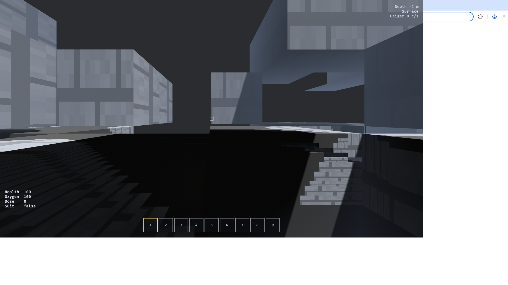

# Deepcore

A co-op 3D voxel mining game in Rust, built on Bevy. Up to 16 players share one persistent
1024 × 1024 × 512-block mine. Everyone starts with a steel pickaxe at a surface camp. Progression
is depth: dig, haul ore home, build a machine, the machine unlocks a better tool or material, dig
deeper. Six Eras take the team from a hand pickaxe to a nuclear reactor and a **Nuclear Drill**
that bores 3 × 3 tunnels.



## Build and run

```bash
# Linux system libraries for Bevy
sudo apt-get install -y libasound2-dev libudev-dev libx11-dev libxkbcommon-dev \
    libwayland-dev libvulkan-dev pkg-config

cargo build --release

# dedicated server (headless, 30 Hz authoritative)
cargo run --release -p deepcore-server --bin deepcore-server -- --port 24288

# client, joining that server
cargo run --release -p deepcore-client -- --connect 127.0.0.1:24288 --name YourName
```

The server also takes `--seed`, `--content`, `--save-dir`, `--simulate-latency` and
`--simulate-loss`. The client takes `--connect`, `--name`, `--content` and `--render-distance`.

## Quality gate

```bash
./scripts/check.sh      # cargo fmt --check, clippy -D warnings, cargo test
```

## Controls

| Key | Action |
|---|---|
| WASD | move |
| Space | jump / climb |
| Shift | sprint |
| Ctrl | crouch |
| Left mouse | mine |
| Right mouse | place the held block |
| Middle mouse | interact with a machine or crate |
| 1–9 | select hotbar slot |
| E | inventory and hand crafting |
| T | tech tree |
| Q | drop the held stack |
| Esc / Tab | release the mouse |
| F3 | debug overlay (FPS, chunks, corrections, networks) |

## Content is data

Blocks, items, recipes, machines, the tech tree, layers and hazard tuning live in
`assets/data/*.ron` and are validated at load: unknown references, dead-end items, tech cycles,
missing parents and layer gaps all fail fast with a readable message. Adding an ore or a recipe
never touches Rust. `cargo run -p deepcore-server --bin balance_report` prints the raw materials
each Era needs and the cost of the nuclear chain.

## Architecture

`shared` holds every rule (voxels, worldgen, movement, inventory, crafting, machines, power,
hazards, protocol) with no rendering and no sockets. `server` decides: it owns the world,
inventories, machines, power networks and hazards, and validates every client intent. `client`
shows: it predicts its own movement with the same shared code and sends intents for everything
else. See `docs/PLAN.md` for the full design and `PROGRESS.md` for the current state.

## Tests

```bash
cargo test --workspace
```

69 tests cover chunk palette round-trips, worldgen determinism and ore placement, the break-time
formula and tier gate, inventory stacking (with property tests), machine ticks, tech tree
deposits, power solving and brownouts, radiation maths, the wire protocol, procedural atlas
generation, greedy meshing, procedural audio, and region-file persistence.
